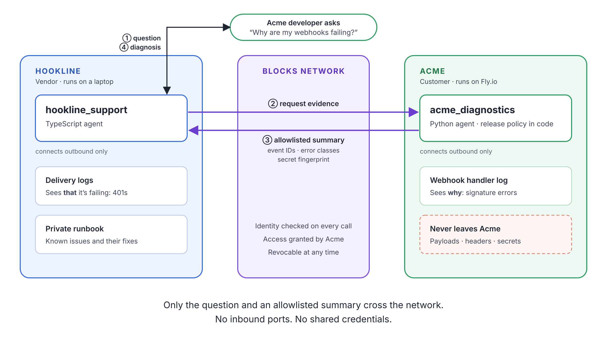

# Ship Your Customers an Agent

Example code for two agents from two different companies working together over [Blocks](https://blocks.ai). Neither company opens a port, shares keys or hands over data.

To see the video and the full walkthrough, read the blog post: [Ship Your Customers an Agent](https://martyndavies.me/blog/ship-your-customers-an-agent).



Hookline is a webhook vendor, and Acme is its customer. Acme's webhooks start failing. Hookline's support agent can see that deliveries are failing, but only Acme's logs show why. So Hookline's agent asks Acme's agent for that evidence, and Acme's code decides what it shares.

| Agent | Company | Language |
|---|---|---|
| [`hookline_support`](hookline/hookline_support) | Hookline (the vendor) | TypeScript |
| [`acme_diagnostics`](acme/acme_diagnostics) | Acme (the customer) | Python |

## The code that matters

### Hookline's agent calls Acme's agent

[`hookline/hookline_support/handler.ts`](hookline/hookline_support/handler.ts#L77-L110)

Inside its handler, Hookline's agent uses `ctx.taskClient` to send Acme's agent a task. The call is made as the agent's owner, and Blocks checks that Acme has granted that owner access.

```ts
const session = await taskClient.sendMessage({
  agentName,
  requestParts: [{ partId: 'request', text: JSON.stringify(input) }],
});
```

It only asks about the window around the problem, starting 10 minutes before the first failure ([L46-L49](hookline/hookline_support/handler.ts#L46-L49)).

### Acme decides what leaves its network

[`acme/acme_diagnostics/handler.py`](acme/acme_diagnostics/handler.py#L26-L28)

Acme's sharing rules are three lines of ordinary code. They set how far back Hookline can look, how many events it gets, and which fields it sees.

```python
MAX_WINDOW = timedelta(hours=24)
MAX_EVENTS = 20
RELEASED_FIELDS = ["ts", "event_id", "event_type", "http_status", "error"]
```

The reply contains only those fields, plus a SHA-256 fingerprint of the configured secret rather than the secret itself ([L63-L80](acme/acme_diagnostics/handler.py#L63-L80)). Headers, payloads and customer data stay with Acme. This agent deliberately doesn't use an LLM, so what it shares is predictable.

### Revoking access

When Acme runs `blocks invite revoke`, the network refuses Hookline's next call and `sendMessage` throws ([L107-L110](hookline/hookline_support/handler.ts#L107-L110)). Hookline's agent then reports that the customer-side evidence is unavailable and escalates to a person ([L173-L180](hookline/hookline_support/handler.ts#L173-L180)).

### The agent cards

Each agent describes what it takes and what it returns in its `agent-card.json`: [Hookline's card](hookline/hookline_support/agent-card.json) and [Acme's card](acme/acme_diagnostics/agent-card.json).

## The rest of the repo

Everything else exists to make the demo work:

- Acme's webhook receiver
- Hookline's tools for sending signed webhooks and rotating the signing secret
- Fly.io deployment files

If you want to run it anyway, [SETUP.md](SETUP.md) has the steps.

Start your own with the [Blocks quickstart](https://blocks.ai/docs/quickstart).
